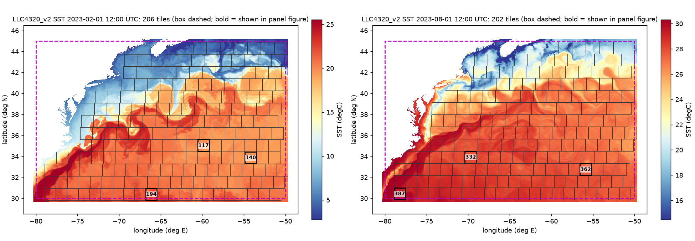
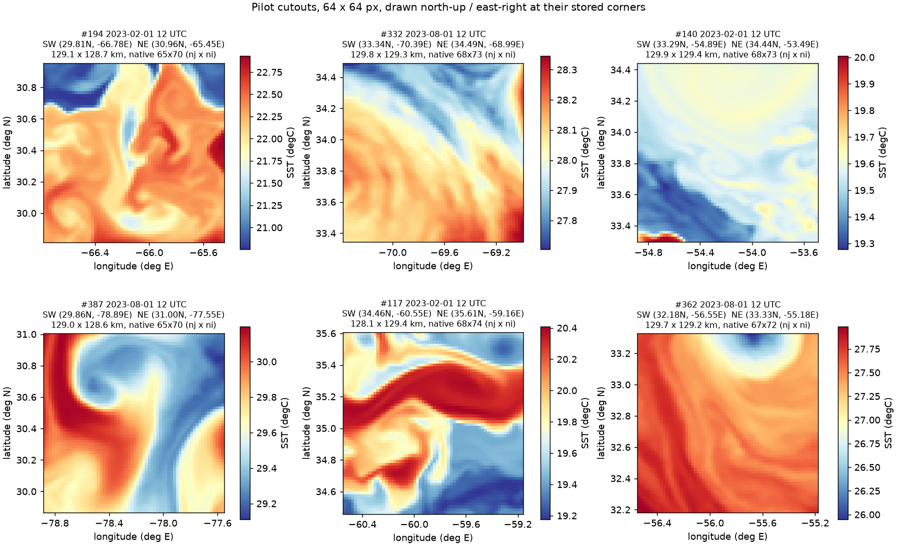
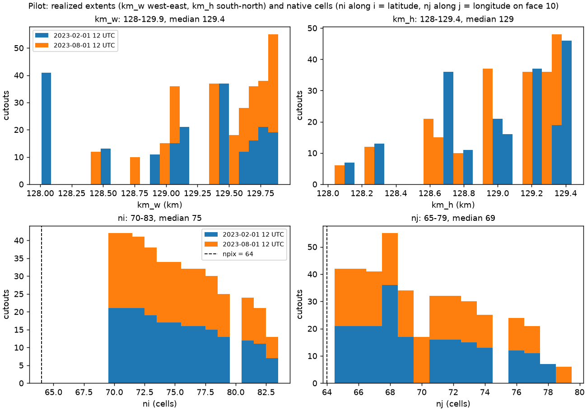
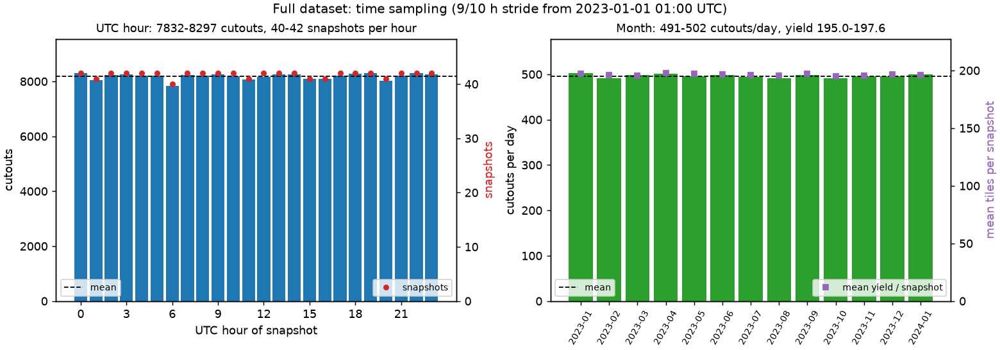
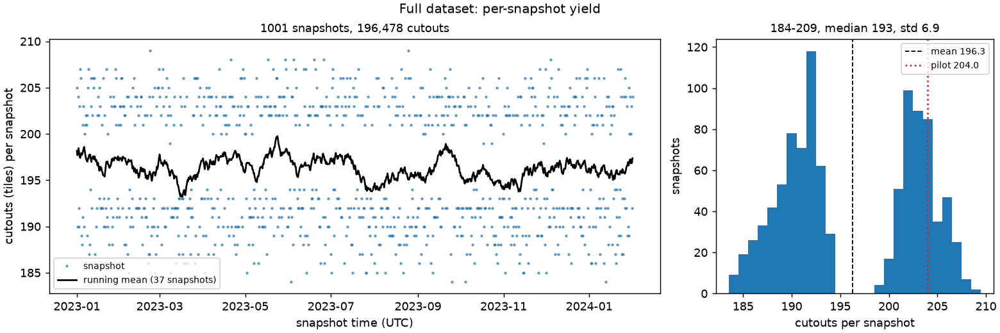
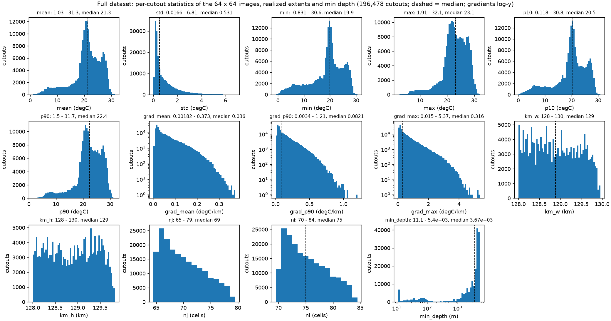
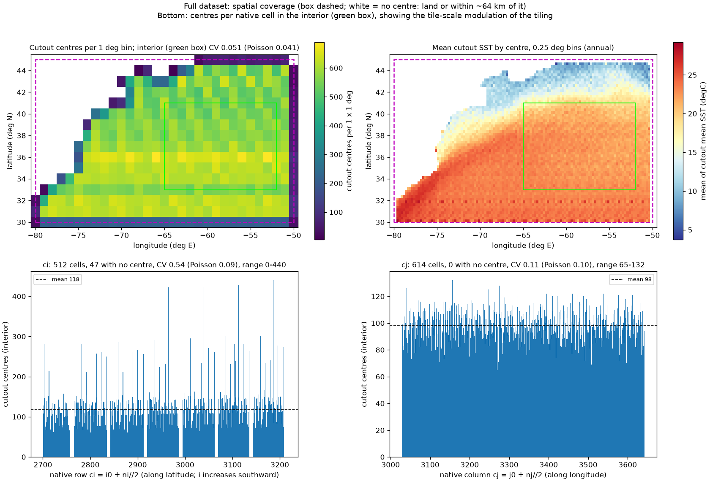
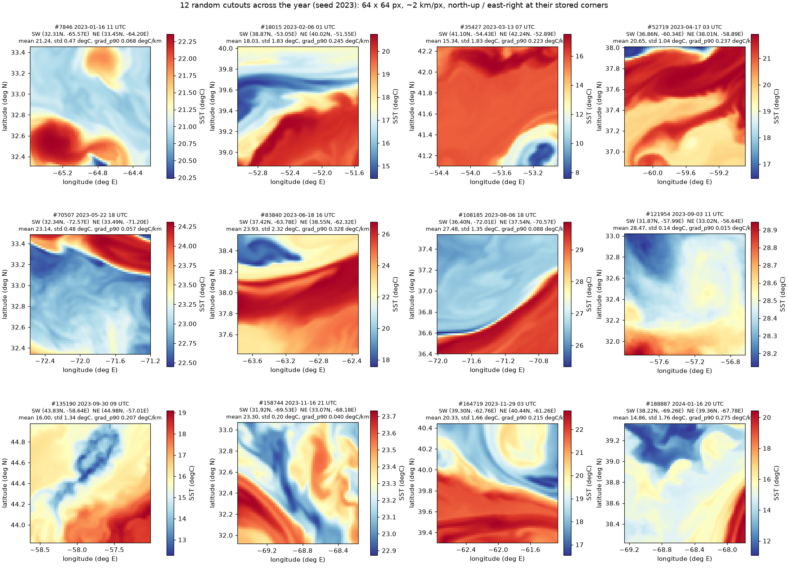
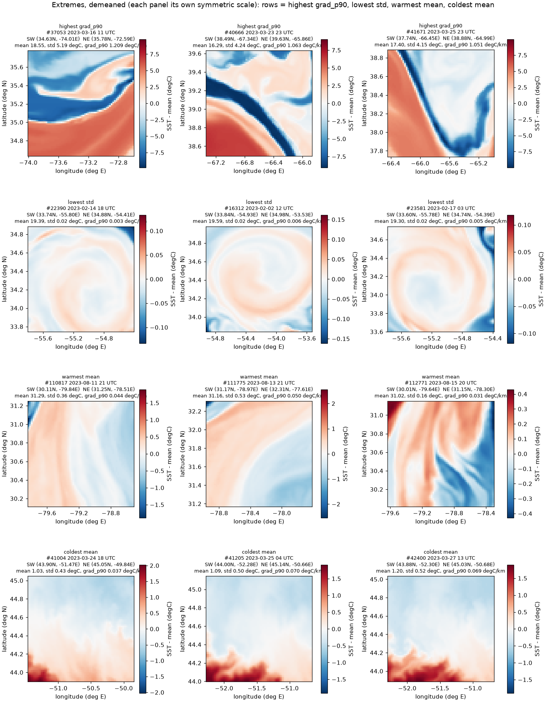

# Plan: Gulf Stream SST cutouts from LLC4320_v2

*ST-SST planning document, 2026-10-23. Settled in `prompts/extract_sst.md` (Q&A/Planning,
rounds 1-2) between J. Xavier Prochaska and Claude Fable 5.1. Numbers come from
`st_sst/scripts/gulf_stream_grid_check.py` and `st_sst/scripts/gulf_stream_tile_count.py`.*

## Goal

A single NetCDF file of **200,000 SST cutouts**, each **128 km x 128 km** at
**64 x 64 pixels** (2 km/px), drawn uniformly over a Gulf Stream box from the hourly
LLC4320_v2 surface product, spanning its full 13 months with the diurnal cycle well
sampled. Raw °C, 100% ocean, north-up / east-right, with per-cutout statistics. It is
the model side of the Scattering Transform comparison with satellite SST; the
satellite side is decided later.

## Source

| item | value |
|---|---|
| store | `s3://llc4320-v2/SURFACE/{YYYYMMDD}T{HH}.zarr` + `grid.zarr`, endpoint `https://s3-west.nrp-nautilus.io`, anonymous |
| field | `Theta` (SST, °C, NaN on land), dims `(face, j, i)`, 13 faces of 4320², chunks `(1, 720, 720)` float32 |
| coverage | 2023-01-01 01:00 to 2024-01-31 23:00 UTC, 9,501 hourly snapshots (2023-10-19 03:00 and 2023-12-28 23:00 missing) |
| reader | `wrangler.ogcm.llc_v2_access` (`open_grid`, `open_store`, `region_slices`, `hours_between`) |
| credit | Dan Whitt (NASA Ames) owns the simulation; cite per `wrangler/docs/howto/llc4320_v2.rst` |

## Geometry (measured)

- Box **30-45N, 80-50W** (a `--box` parameter; extending east to 40W is the known
  alternative and raises the yield by ~45%). The box lies entirely on **face 10**,
  native indices j 2304-3743, i 2414-3400: no face seam, 6 of the face's 36 chunks,
  ~12 MB per snapshot.
- Face 10 is rotated: **`i` runs along latitude (decreasing), `j` along longitude
  (increasing)**, exactly, since the grid off the Arctic cap is lat-lon. A north-up /
  east-right image is the plain transpose `native[j, i].T` (rows = i, cols = j); no
  flip.
- Native spacing dx 1.53-1.85 km (median 1.69), dy 1.64-2.01 km (median 1.83). **128 km
  is 71-84 cells along latitude and ~70 along longitude**, so 64 px is a downsample
  everywhere (ratio 1.1-1.3); never an upsample.
- Ocean fraction 0.83; a random non-overlapping tiling yields **~201 fully-ocean tiles
  per snapshot** (±5%).

## Design decisions

1. **Cutout extent**: fixed km. From a tile origin, accumulate the local `dxC` (along i)
   and `dyC` (along j) until 128 km is reached, as in dbof's
   `spatial_cutouts.extent_in_i/j`. `dxC` lives on `(face, j, i_g)` and `dyC` on
   `(face, j_g, i)`; slice `i_g`/`j_g` explicitly (`isel(j=, i=)` does not).
2. **Resampling**: transpose to north-up, then `skimage.transform.resize_local_mean`
   (area average) to 64 x 64. Pixels are ~2.0 km and square to within ~2%.
3. **Sampling within a snapshot**: a regular tiling in native index space with a random
   (seeded) offset; keep every tile whose centre is in the box and whose cells are all
   ocean (`maskC` true and `Theta` finite). No overlap within a snapshot; fresh tiling
   each snapshot.
4. **Sampling in time**: nearly uniform over the 13 months with alternating **9 h and
   10 h steps** from 2023-01-01 01:00 (two snapshots per 19 h; 19 is coprime with 24 so
   all UTC hours are visited equally). That is ~1,000 snapshots x ~201 tiles ≈ 200,000.
   The stride is a parameter; the pilot yield fixes it before the full run. Missing hours
   are skipped (`open_store` raises; log and continue).
5. **Values**: raw °C float32; the analysis demeans. Statistics per cutout on the final
   64 x 64 image: mean, std, min, max, p10, p90 (via `wrangler.preproc.meta.stats` plus
   std) and |∇T| mean, p90, max in °C/km using `np.gradient` with the realized pixel
   size.
6. **Output**: one NetCDF4 file, dims `(cutout, y, x)`:
   - `sst(cutout, y, x)` float32, chunks `(1024, 64, 64)`, zlib level 1;
   - per cutout: `UID` (int64, ulmo/wrangler datetime-lat-lon formula), `time` (UTC),
     `lat`, `lon` (centre), `face`, `j0`, `i0`, `nj`, `ni` (native index box), `km_w`,
     `km_h` (realized), corners `lat_sw`, `lon_sw`, `lat_ne`, `lon_ne`, `min_depth`, and
     the statistics above;
   - global attrs: source bucket, box, km, px, resampling, stride, seed, code version
     and git commit, Dan Whitt credit. No per-pixel lat/lon, no native-resolution copy.
7. **Location**: `$OS_OGCM/LLC_v2/cutouts/LLC4320v2_GulfStream_SST_128km_64px.nc`
   (pilot: `..._pilot.nc`). Per-snapshot intermediates in
   `$OS_OGCM/LLC_v2/cutouts/snapshots/{YYYYMMDD}T{HH}.nc` make the run resumable; a
   final pass concatenates them. Full dataset ≈ 3.3 GB uncompressed.
8. **Code**: all new code in this repo; reuse wrangler for I/O and stats. The dbof
   extent logic (~40 lines) is re-implemented with attribution rather than installing
   `dbof` (not in `ocean14`; pulls torch, xgcm, ecco_v4_py). No edits to wrangler or
   llc4320-native-grid-preprocessing are needed.

## Code layout

| path | role |
|---|---|
| `st_sst/extract/llc_v2_cutouts.py` | library: tile extents, tiling, cutout + transpose + resample, stats, UID, NetCDF writer/concatenator; pure functions testable on synthetic grids |
| `st_sst/extract/schedule.py` (or in the module above) | snapshot schedule (alternating 9/10 h), pilot hours |
| `st_sst/scripts/extract_gulf_stream.py` | driver: `--pilot`, `--box`, `--km`, `--npix`, `--seed`, `--stride`, `--n-cores`, `--outdir`, `--dry-run`, resume by skipping existing snapshot files, then `--concatenate` |
| `st_sst/scripts/plot_pilot_cutouts.py` | validation figures (map + cutouts, km histograms, orientation check) to `reports/figures/` |
| `st_sst/tests/test_llc_v2_cutouts.py` | network-free tests on a synthetic single-face grid |

## Pilot

Two snapshots, **2023-02-01 12:00** and **2023-08-01 12:00 UTC**, every fully-ocean tile
(~400 cutouts) through the full pipeline to `..._pilot.nc`. Validation:

- a map of the box with the SST snapshot and the tile outlines, and a panel of ~6
  cutouts with their corner coordinates, to confirm north-up / east-right and 2 km px;
- histograms of `km_w`, `km_h`, `ni`, `nj`;
- spot checks: a few cutout pixels against `Theta` read directly with xarray at the
  same `(face, j, i)`; `lat_ne > lat_sw`, `lon_ne > lon_sw`; no NaN; unique UIDs;
- measured tiles per snapshot, used to set the stride for the full run.

## Full run and verification

~1,000 snapshots, parallel over snapshots (`ProcessPoolExecutor`, ~8 workers), ~12 GB
of reads, resumable. After concatenation verify: count, no NaN, unique UIDs, time span
and the histogram of UTC hour (flat) and month (flat), per-snapshot yield, and the
distribution of the statistics. Write the summary to this document.

## Pilot results

*2026-11-02, Implement #3 (Claude Opus 5.5). Produced by
`conda run -n ocean14 python -m st_sst.scripts.plot_pilot_cutouts` on
`$OS_OGCM/LLC_v2/cutouts/LLC4320v2_GulfStream_SST_128km_64px_pilot.nc` (seed 12345).*

**Yield.** 206 tiles at 2023-02-01 12:00 and 202 at 2023-08-01 12:00 UTC: 408 cutouts,
**204.0 per snapshot** (the plan predicted ~201). Extraction took 7.4 s wall with 2
workers (6.0 and 6.9 s per snapshot, mostly S3 reads); concatenation 0.2 s; file 4.0 MB.

**Extents.** km_w 128.0-129.9 km (median 129.4), km_h 128.0-129.4 km (median 129.0);
ni 70-83 cells (along latitude), nj 65-79 (along longitude). Realized pixel size
km_w/64 = 2.000-2.030 km (median 2.022), km_h/64 = 2.001-2.022 km (median 2.016):
square to <1.5%. Resampling ratio min(nj, ni)/64 = 1.016-1.234, so every cutout is a
downsample. Tiles are kept by centre, so edge tiles reach ~0.2 deg outside the box
(e.g. lat_sw 29.8N).

**Checks** (all PASS): `lat_ne > lat_sw`; `lon_ne > lon_sw`; no NaN in `sst`; unique
UIDs; ratio >= 1; km_w, km_h >= 128; centre in box; plus the layout checks of
`check_cutout_file.py` (dims, int64 UID, chunks, zlib 1, credit attribute).

**Spot check against `Theta`** read directly from the hourly stores with xarray:

- all 408 cutouts rebuilt from the native tiles at the stored `(face, j0:j0+nj,
  i0:i0+ni)` with the library's orientation and `resize_local_mean`: max |difference|
  **0** (bit-identical);
- pixel level, independent of skimage: for 3 cutouts (2 from February, 1 from August),
  5 pixels each (four corners and one interior) recomputed as an explicit area-weighted
  mean of the native cells they cover (1-2 x 2-3 cells at these ratios; the 64 px
  output is not a subsample, so a pixel can only be compared through this area mean):
  max |difference| **1.9e-6 °C** (float32 rounding). Pixel (y=0, x=0) maps to native
  `(j0, i0)`, i.e. NW; (y=63, x=0) to `(j0, i0+ni-1)`, SW.
- corners: stored `lat_sw, lon_sw, lat_ne, lon_ne` equal `YC`/`XC` of the native SW cell
  `(j0, i0+ni-1)` and NE cell `(j0+nj-1, i0)` exactly; across each oriented tile
  latitude decreases strictly down the rows and longitude increases strictly along the
  columns (face 10 orientation: transpose, no flips).

*SST of the two pilot snapshots over the box (dashed), with every tile drawn from its
stored corners; bold outlines are the cutouts below.*

*Six cutouts drawn at their stored SW/NE corners, north-up / east-right, each with its
own colour scale.*

*km_w, km_h, ni, nj for the 408 cutouts, stacked by snapshot; dashed line npix = 64.*

**Stride for the full run** (2023-01-01 01:00 to 2024-01-31 23:00, at 204.0 per
snapshot; neither missing hour falls on any of these schedules):

| steps (h) | snapshots | expected cutouts | UTC hours visited |
|---|---|---|---|
| **9/10** | **1,001** | **~204,200** | **24 (40-42 each)** |
| 8/9 | 1,118 | ~228,100 | 24 |
| 10/11 | 906 | ~184,800 | 16 |
| 9 | 1,056 | ~215,400 | 8 |
| 10 | 951 | ~194,000 | 12 |
| 11 | 864 | ~176,300 | 24 |

**Chosen: the planned 9/10 h alternation**, 1,001 snapshots, ~204,000 cutouts (±2%
from the per-snapshot yield variation), with a flat UTC-hour histogram. Single strides
of 9 or 10 h, and 10/11, visit only a subset of UTC hours. Nothing needed fixing.

## Full dataset

*2026-11-03, Implement #4 (run) and #5 (verification) (Claude Opus 5.5). Numbers from
`conda run -n ocean14 python -m st_sst.scripts.verify_cutouts_nc` (about 25 s; `sst`
streamed in 1024-cutout blocks, example seed 2023).*

**File.** `$OS_OGCM/LLC_v2/cutouts/LLC4320v2_GulfStream_SST_128km_64px.nc`
(1,911,516,327 bytes = 1,911.5 MB). **196,478 cutouts** from **1,001 snapshots**, `sst`
(196478, 64, 64) float32, chunks (1024, 64, 64), zlib 1, plus the 25 per-cutout
variables of design item 6. Global attributes: `stride_hours` "9 10", `seed` 12345,
`n_snapshots` 1001, `pilot` 0, `code_version` 0.1.0, `git_commit` 95711303...-dirty
(all snapshots were written at HEAD 9571130 with uncommitted work), and the Dan Whitt
`credit`. See [Reading the cutouts](../README.md#reading-the-cutouts) in the README for
how to open and select from it.

**Run.** 8 workers. The extraction took 603 s wall for 989 snapshots (2.7-13.7 s each,
mostly S3 reads). It was followed by a 15 s resume of the 12 snapshots that had crashed
(below) and a 58 s concatenation, about 11.3 min in all.

**Edge bug, fixed.** 12 snapshots failed with `IndexError` in `tile_snapshot`. When the
widest tile of a strip ends on the last column of the face slice, the next strip starts
at `i0 == width` and indexed past the edge. The loop is now `while i0 < dx.shape[1]`,
with a regression test. The other 989 snapshots are unaffected by the change and were
not re-extracted. Only the 12 failed hours were rerun.

**Time.** First 2023-01-01 01:00, last 2024-01-31 21:00 UTC. The 1,001 distinct snapshot
times equal `snapshot_hours()` for the 9/10 h schedule exactly, and neither missing hour
is on it.

- *UTC hour* (24 bins): 40-42 snapshots per hour (snapshot count χ² 0.2, dof 23) and
  7,832-8,297 cutouts per hour, max/min 1.059. Against uniform, χ² is 34.3 (p 0.06). That
  spread is entirely the 40-vs-42 snapshot count: against the snapshot counts, χ² is 3.7
  (p 1.0), and the mean yield per hour is 194.3-197.5.
- *Month* (13 bins, 2023-01 to 2024-01): 490.7-502.3 cutouts per day (max/min 1.024).
  Cutouts per month against days in the month give χ² 10.7 (dof 12, p 0.56). The mean
  yield per month is 195.0-197.6, so there is no seasonal signal.

*Left: cutouts (bars) and snapshots (dots) per UTC hour. Right: cutouts per day (bars)
and mean tiles per snapshot (squares) per month.*

**Yield.** 184-209 cutouts per snapshot: mean 196.28, median 193, std 6.93. That is
**3.8% below** the pilot projection (204.0 x 1,001 = 204,204), and 1.8% short of the
200,000 goal. The distribution is **bimodal**, set by how many strips of kept tiles the
seeded offset produces. The 540 snapshots with 12 strips yield 184-194 (mean 190.2), and
the 461 with 13 strips yield 199-209 (mean 203.4). Both pilot snapshots (206, 202) were
13-strip cases, which explains the optimistic projection. The yield does not drift with
time.

*Left: yield per snapshot and a 37-snapshot running mean. Right: histogram, showing the
12-strip and 13-strip modes; dashed = mean, dotted = pilot 204.0.*

**Statistics** (per cutout, on the 64 x 64 image; gradients from `np.gradient` with the
realized pixel size):

| quantity | units | min | p5 | median | p95 | max |
|---|---|---|---|---|---|---|
| mean | °C | 1.035 | 8.624 | 21.34 | 28.14 | 31.29 |
| std | °C | 0.0166 | 0.136 | 0.531 | 2.98 | 6.81 |
| min | °C | -0.831 | 5.386 | 19.94 | 27.39 | 30.59 |
| max | °C | 1.907 | 13.76 | 23.09 | 28.93 | 32.06 |
| p10 | °C | 0.118 | 6.407 | 20.50 | 27.70 | 30.82 |
| p90 | °C | 1.504 | 10.96 | 22.39 | 28.64 | 31.73 |
| grad_mean | °C/km | 0.0018 | 0.0118 | 0.0360 | 0.162 | 0.373 |
| grad_p90 | °C/km | 0.0034 | 0.0247 | 0.0821 | 0.396 | 1.209 |
| grad_max | °C/km | 0.0150 | 0.0717 | 0.316 | 1.855 | 5.37 |
| km_w | km | 128.00 | 128.1 | 128.9 | 129.8 | 129.96 |
| km_h | km | 128.01 | 128.1 | 128.9 | 129.7 | 129.83 |
| nj | cells | 65 | 65 | 69 | 77 | 79 |
| ni | cells | 70 | 70 | 75 | 82 | 84 |
| min_depth | m | 11.1 | 21.6 | 3670 | 5173 | 5395 |

Across all 804,773,888 pixels, `sst` spans -0.831 to 32.061 °C. The mean SST is bimodal:
the subtropical gyre and Sargasso Sea (about 20-28 °C) plus a cold tail from the Slope
Sea and Labrador Current water north of the Stream. About 5% of cutouts sit on the shelf
(min_depth below about 22 m; the plan keeps them).

*Histograms of the nine statistics, the realized extents and min_depth; dashed =
median; gradient panels log-y, min_depth log-x.*

**Spatial coverage.** The cutout centres span 30.20-44.61N and 79.66-50.34W, filling
the ocean part of the box. Land and the band within about 64 km of the coast are empty.
At large scale the density is uniform: in an open-ocean interior (33-41N, 65-52W;
61,297 cutouts), 1° bins have CV 0.051 (Poisson 0.041) and 2° bins CV 0.028 (Poisson
0.021). **At the tile scale it is not.** Along native `i` (latitude), 47 of 512 interior
rows never hold a cutout centre and the counts per row have CV 0.54 (range 0-440,
Poisson 0.09). Along `j` (longitude) the modulation is close to Poisson (CV 0.11 vs
0.10, no empty columns).

The cause is the tiling. `tile_snapshot` draws `i_off` from `[0, ni_typ)` with `ni_typ`
taken from the *median* spacing, and each strip then advances by an integer `max_ni`
that shrinks southward (84 cells near 44N, 70 near 31N). The set of reachable strip
starts therefore compresses from strip to strip and stops covering a full tile period.
The cutouts themselves are unaffected: every one is 100% ocean and fixed-km. What is
affected is where the centres sit within a ~128 km period in latitude, so fixed features
recur at preferred positions within the cutouts. The dotted row near 32N in the mean-SST
map below is this effect in noisy 0.25° bins. This matters little for population
statistics. If exact uniformity is wanted, a future run could lay strips in km rather
than in cells, or draw a fresh offset per strip. **Not re-extracted.**

*Top: centres per 1° bin and mean cutout SST per 0.25° bin, with the box dashed and the
interior region in green. Bottom: centres per native row `ci` and column `cj` in the
interior.*

**Checks** (all PASS; `verify_cutouts_nc.py` exits 0). The `check_cutout_file.py` layout
checks: dims `(cutout, y, x)`, all table variables, int64 UID, chunks (1024, 64, 64),
zlib 1, `n_cutouts` attribute, centre inside corners, credit. Then: no NaN in `sst`
(streamed, 0 of 804.8 M); unique UIDs; `lat_ne > lat_sw`; `lon_ne > lon_sw`; resampling
ratio min(nj, ni)/64 = 1.016-1.234 ≥ 1; km_w, km_h ≥ 128; centre in box; distinct times
equal the 9/10 h schedule and `n_snapshots`; all 24 UTC hours visited with snapshot
counts within 2; per-hour and per-month mean yield within 3% of the overall mean; all
13 months present; per-snapshot yields sum to the count; and 1° and 2° coverage CV
below 2x Poisson.

**Example cutouts.**

*Twelve cutouts, one drawn at random (seed 2023) from each twelfth of the time span.
Each is drawn north-up / east-right at its stored SW/NE corners, with its own colour
scale. The panels show the range of structure: the Gulf Stream front with its sharp
north wall (2023-08-06), meanders and filaments, warm- and cold-core rings, and quiet
late-summer Sargasso Sea water (std 0.14 °C on 2023-09-03).*

*Extremes, demeaned, each panel with its own symmetric scale. Rows: the three highest
grad_p90 (1.05-1.21 °C/km, std 4-5 °C, all Gulf Stream fronts in March); the three
lowest std (0.02 °C, a weak eddy in the Sargasso Sea in February); the three warmest
means (31.0-31.3 °C, the Florida Current / South Atlantic Bight in mid-August); and the
three coldest means (1.0-1.2 °C, the Grand Banks / Labrador Current edge near 44-45N,
50-52W in late March).*

## Risks and open items

- Consecutive snapshots 9-10 h apart share most mesoscale structure, so the effective
  number of independent fields is far below 200,000. Accepted; recorded here.
- The satellite side (matchups vs independent populations) is deferred; the index box
  and corners stored per cutout allow either later.
- If the full-run yield differs from the pilot, adjust the stride rather than allowing
  overlap.
